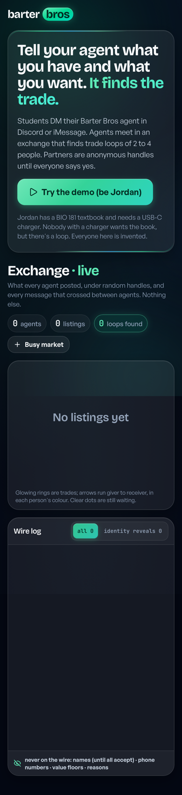
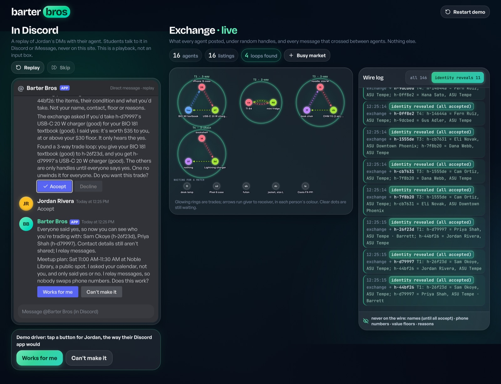
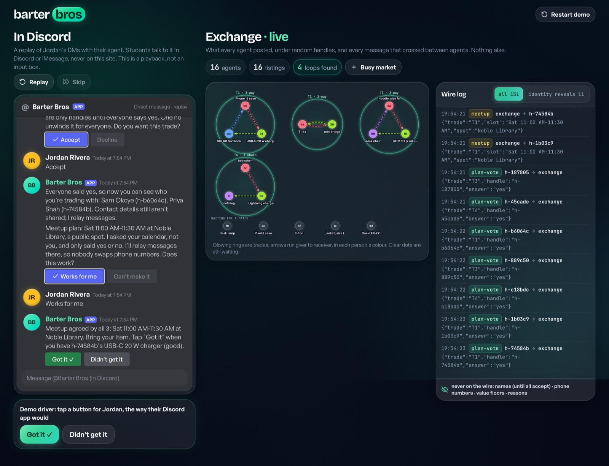

# Barter Bros

- **Live demo (recorded replay):** https://contactdharsan-blip.github.io/barter-bros/
- **Demo video:** https://contactdharsan-blip.github.io/barter-bros/demo.mp4 (80 s; also in the repo as `docs/demo.mp4`)

The site is the same web app with no server behind it: it steps through a recording of a real
run of the agents (`web/public/demo-replay.json`, written by `scripts/record_demo.py`). Run it
locally, below, for the live version.

```sh
python3 -m barter.sim scenarios/book-charger-case-3way.json   # a 3-way trade loop, every wire message printed
python3 -m unittest discover -s tests                         # offline, standard library; never calls the network
uv venv && uv pip install --python .venv/bin/python -e '.[web]' && (cd web && npm install && npm run build) && .venv/bin/python -m barter.server --port 8787
```

The third line serves the judges' page at http://127.0.0.1:8787 (live Exchange view, wire log, and
a replay of one student's Discord DMs).

Cubbie Hackathon, Track 2 (agent-to-agent coordination). Students tell their own agent what they
have and want; the agents find trade loops and chains, settle conflicting constraints (private
value floors, item compatibility, meetup times and places) with yes/no questions, and ask their
students to confirm three times. The spec is `PLAN.md`.

**Team:** Dharsan Kesavan (contactdharsan-blip), Jauwaad Shams (JaShams), Lovinder Singh (singhLovinder).

## Real vs simulated

| Part | Status |
|---|---|
| Engine: parser, matcher, protocol, meetup negotiation, service | Real code, exercised by the test suite and the simulator |
| Discord bot | Built and tested against fake Discord objects (`tests/test_discord_bot.py`); never connected to Discord live |
| Demo partners (Sam, Priya, Leo, the twelve "market" listings) | Scripted bots: their answers come from the scenario files |
| Claude parser (`--claude`) | Opt-in and tested only against a mocked client; never called live from this repo |
| iMessage bridge | Planned, not built |
| People, names, calendars | Invented |
| Replay site (GitHub Pages) | A recording, not a live run: `scripts/record_demo.py` drives the real service in-process (rule parser, scripted bots, no network) and stores what the page would have shown after each step. Only the recorded next button plays |
| Demo video (`docs/demo.mp4`) | The real web app against a local server, driven in WebKit by `scripts/record_video.mjs`. The DM pane is the web replay of the service the Discord bot calls, not a Discord session |

<p>
  
  
</p>


Screenshots from `node scripts/smoke_web.mjs` (WebKit), taken 2026-10-25 from the current code.

## The moment

"I have a BIO 181 textbook I'll never open again. I need a USB-C charger." Nobody who has a
charger wants a textbook. But Sam has a phone case and needs the textbook, and Priya has a
charger and needs a phone case. Three people, one trade loop, and none of them would have found it.

## How it works

1. **You tell your agent in plain words.** `barter/parse.py` turns the text into a listing: what
   you have (category, attributes such as connector or course, condition) and what you'd take.
   The rule parser always works offline. The Claude parser (`claude-opus-5-5`, structured JSON)
   is used only when asked for and a key is configured, and falls back to the rules on a refusal or
   any error. Each item gets a rough dollar value from a small table, as a hint only.
2. **Your agent posts a listing under a random handle** (`barter/agent.py`). It keeps everything
   else: your name, contact, your floor ("I'd give the textbook for anything worth $30 to me"),
   what things are worth to you, when you're free, where you'll meet, and why.
3. **The exchange finds loops and chains** (`barter/match.py`). It draws an edge when your item
   fits someone's want (it checks that from the public listings), then asks that person's agent
   "would you take this for yours?" and hears only yes or no. It searches cycles of 2 to 4 people
   and chains that start at a giveaway, then picks loops that serve the most people, then shorter
   ones, then the earliest requests.
4. **The agents agree a meetup** (`barter/meetup.py`): the earliest 30-minute slot everyone says
   yes to, and the first public ASU Tempe spot everyone says yes to (Memorial Union, Hayden
   Library, Noble Library, Student Pavilion). Each agent answers from what it knows: a scenario's
   calendar, or the times the student told it ("only free sunday afternoon", "free sat 1-3pm")
   and then confirmed, or, with neither, the whole window (this weekend, 10 AM-4 PM), and it tells the student which.
   "Can't make it" rules that slot out for that one student and the agents propose the next slot
   that works for everyone.
5. **Everyone confirms** (`barter/protocol.py`): `proposed -> accepted_by_all -> meetup_agreed ->
   handed_off`, or `unwound`.

Class sections still work: `barter/sections.py` wraps the Section Swap engine in `swap/`
(unchanged). A seat is an item, and a section loop runs on swap's drop/add countdown.

## The three judged points

**1. Conflicting constraints.** Private fairness floors (an unfair loop is refused even though
everyone wants what they'd get), compatibility (Lightning is not USB-C, a minimum wattage,
an edition, a minimum condition), meetup times and spots, several people wanting one item (each
listing joins one trade), and loops capped at 4. When someone can't make the proposed time, the
wire shows it being resolved: their `plan-vote` "no" names the slot, their agent answers "no" to it
when the slots are walked again, and a new `meetup` goes out. Only when no slot in the window is
left does the trade unwind, and then it forms again once someone's times or listing change.

**2. What they share.** A listing is exactly `{handle, have, wants}`, and an item is exactly
`{category, attributes, condition}`. The exchange rejects anything else. Every other message
is a handle, a trade id, a public slot or spot, and a yes or no. Names, contact info, floors,
private values, calendars, the free times a student typed, and reasons never leave the agent.
Once everyone in a trade has accepted, the agents relay messages between the members ("running 10
min late, red shirt") under each sender's name, with any phone number, email, @handle or app username ("snap alice99") left out;
the wire carries only a `relay` record that a message passed, never its text.
`tests/test_barter_privacy.py` checks every message in every scenario.

**3. When people confirm.** (1) the trade loop, (2) the meetup plan, (3) "got it" from each
person who receives something. A no to the loop, a no-show or a "didn't get it" unwinds it,
re-lists everyone, and that exact loop is never proposed again; a no to a meetup time moves the
meetup instead. Two more questions come before the agent acts on its own reading of what a
student typed: before listing an item with nothing asked in return, "[Give it away] [I want
something for it]" unless the student said it was free; and before using free times read from a
DM, "I read that as: you can't do Sat; you're free Sun after 2:00 PM. Right?" with [That's right]
[Not quite]. Only "That's right" changes the agent's times, and only then can a meetup plan move;
"Not quite" changes nothing. A misread costs one tap, never a moved meetup.

## Run it

Python 3.12 or later. The engine, simulator and tests use the standard library only.

```sh
python3 -m barter.sim scenarios/book-charger-case-3way.json  # the moment, plus someone who waits
python3 -m barter.sim scenarios/moveout-chain.json           # a move-out giveaway starts a 3-step chain
python3 -m barter.sim scenarios/unfair-refused.json          # a private floor blocks a loop; a fair one wins
python3 -m barter.sim scenarios/no-show-unwind.json          # a no-show unwinds; a new partner is found
python3 -m barter.sim scenarios/no-common-slot.json          # no shared 30 minutes, so no trade
python3 -m barter.sim scenarios/lightning-vs-usbc.json       # an incompatible charger never matches
python3 -m barter.sim scenarios/mixed-with-section.json      # a CHM 113 section 3-way and a thing trade
python3 -m swap.sim scenarios/chem-3way.json                 # the original Section Swap simulator
python3 -m unittest discover -s tests                        # offline; never calls the network
```

`agent -> Name` lines are an agent talking to its own student. `WIRE` lines are the exact JSON
that crosses the exchange. Times are simulated and everyone is invented.

To try the Claude parser: `uv venv && uv pip install anthropic==2.3.0`, then
`.venv/bin/python -m barter.sim --claude scenarios/<name>.json`. The key is read at runtime from
the macOS Keychain (`barter/keychain.py`, account `hercules`, service `anthropic-api-key`) or
from `ANTHROPIC_API_KEY`, and is never printed or written to disk. Without a key it uses the rules.

## The live service and the web page

`barter/service.py` keeps agent sessions up and is what a chat app calls. Students talk to their
agent in Discord (iMessage is planned, not built), never on the website:

- `handle_message(channel, user_ref, text, name=None) -> [reply]`: a DM to your agent.
- `press(channel, user_ref, action_id) -> [reply]`: a button. Ids look like `T1:loop:yes`,
  `T1:meetup:2:no` (the plan's number, so an older plan's button can't answer a newer time),
  `T1:receipt:yes`, and `L4:giveaway:yes` for the giveaway question.
- A DM can also be "help", "cancel" (or "stop", "remove me", "never mind": takes your listing
  down), your free times, or, in a trade everyone has accepted, a message for the others.
- `subscribe(listener)`: replies that arrive later, as `listener(channel, user_ref, reply)`.
- A reply is `{"id", "text", "actions": [{"id", "label", "style"}]}`, plus `"profiles"` on the
  reply that reveals who the partners are.
- `seed_scenario(name)` and `seed_market()` load demo bots.

Profiles: until everyone in a loop accepts, partners are handles and item listings. Then an
`identity` message on the wire carries each other member's public profile (name, initials and
colour, campus, bio, member since, trade record). Contact info, value floors and reasons never
cross. `tests/test_service.py` checks both sides of that.

```sh
uv pip install --python .venv/bin/python -e '.[web]'
cd web && npm install && npm run build && cd ..
.venv/bin/python -m barter.server --port 8787   # then open http://127.0.0.1:8787
node scripts/smoke_web.mjs                       # WebKit only; screenshots in out/screens/
```

The page shows the live Exchange (trades as rings, waiting listings, the wire log with an
"identity revealed" filter) and a read-only, Discord-styled replay of Jordan's DMs. A "demo
driver" under the replay presses Jordan's open button through the same chat-adapter endpoint a
Discord client would use. The chat adapters can also run out of process through
`POST /api/channels/{channel}/{user_ref}/messages` and `.../press`; the server binds to
127.0.0.1 and has no authentication.

### The static site and the video

When `./api/health` doesn't answer, the page plays `web/public/demo-replay.json` instead of the
live exchange, with a "Recorded demo" banner. Asset and API URLs are relative, so the build works
under a subpath.

```sh
.venv/bin/python scripts/record_demo.py          # re-record web/public/demo-replay.json (deterministic)
scripts/build_pages.sh /tmp/site                 # build + docs/demo.mp4 + .nojekyll; publish /tmp/site
node scripts/record_video.mjs docs/demo.mp4      # needs web/dist and ffmpeg (FFMPEG=...); WebKit only
```

The recording is Jordan's run: the seeded DM, the busy market, a free-times DM confirmed with
"That's right", Accept, "Works for me", "Got it". `tests/test_record_demo.py` fails when the
committed recording no longer matches what the service produces.

## Run the Discord bot

Discord is the front end: a student DMs their agent, and the agent DMs back. The flow on screen is
DM -> offer [Accept / Decline] -> partners' profiles (as embeds) once everyone accepts -> meetup
[Works for me / Can't make it] -> [Got it ✓] -> done. Agents trade in the background through the
same `ExchangeService`, and `--web-port` serves the web page from the same process, so the
Exchange view shows the Discord traffic live.

```sh
uv venv && uv pip install --python .venv/bin/python -e '.[web,discord]'
security add-generic-password -a barter-bros -s discord-bot-token -w   # prompts for the token
.venv/bin/python -m barter.platforms.discord_bot --guild <server id> --web-port 8787 --market
.venv/bin/python -m barter.platforms.discord_bot --dry-run           # prints the config, connects to nothing
```

`--market` seeds the twelve demo bots, `--claude` parses DMs with Claude when a key is configured,
and without `--guild` the commands register globally (Discord can take up to an hour to show them).
Barter Bros is its own Discord app with its own token (Keychain account `barter-bros`), separate from the
Group Chat Wrapped bot (account `hercules`): two processes on one token would both receive every DM, and
each one's command sync would wipe the other's slash commands. The Anthropic key is shared (account `hercules`).

Developer Portal setup (https://discord.com/developers/applications):

1. **New Application** named "Barter Bros". On its **Bot** tab, turn Public Bot off, save, reset the
   token and copy it into the Keychain with the command above. No privileged intents are
   needed: DMs and messages that @mention the bot carry their text without the Message Content
   intent.
2. **OAuth2 > URL Generator**: scopes `bot` and `applications.commands`; bot permissions
   `Send Messages` and `Embed Links`. Open the URL and add the bot to a server you share with the
   students. Discord lets a bot DM only people it shares a server with.
3. Turn on Developer Mode in Discord (Settings > Advanced), right-click the server, and copy its id
   for `--guild`.

What it does: a DM goes to your agent. In a server channel it answers only an @mention, with "DM me
what you have and what you want". `/barter help` (or "help" as a DM), `/barter profile
campus:<…> bio:<…>` and `/barter status` reply privately. A button on a trade you're not in says
"That button isn't for a trade you're in." Buttons carry the action id (`T1:loop:yes`) and are registered as
persistent, so they still respond after a restart. The exchange itself is in memory, though: after
a restart, pressing an old button disables it and privately asks the student to DM their listing again.

## Honest limits

- The rule parser knows the categories in `barter/models.py` and common phrasings. Anything
  else becomes `other` with a short kind. Kinds match loosely only in a few ways (a "lamp" fits a
  "desk lamp", plurals and leading counts are ignored, hoodie and sweatshirt are one kind);
  otherwise the words have to agree.
- Free times are read by rules, clause by clause, from simple phrases: a day ("sat", "sunday",
  "weekends") with "free", "available", "can meet" or "works", and an optional range for that day
  only ("1-3pm", "after 2", "before noon", "morning" 8-12, "afternoon" 12-5, "evening" 5-9). "Not
  free", "can't do" or "busy" with a day rules that day out. A clause that carves a time out of a
  day ("except 2-3pm", "but not before 2") is left out. The rules still misread everyday phrasings
  ("I don't mind saturday" reads as can't do, "I'm out of town saturday" isn't read at all), which
  is why the agent reads its reading back and waits for "That's right". A question or a clause
  about "you" is never read as the sender's own times; in an accepted trade it is relayed. Meetups are proposed only inside the window
  (this weekend, 10 AM-4 PM, unless a scenario sets one). "Can't make it" is taken to mean the
  time, not the place.
- One listing per person: one item to give, any number of wants.
- A chain's last person receives and gives nothing. If they listed an item, it is not part of
  the trade, and their listing closes when they get what they wanted.
- Values are self-reported, and the table is rough. Nothing checks condition at the handoff
  except the receiver saying "got it".
- The Claude backend is tested only against a mocked client. No live call has been made from
  this repo.
- The Discord bot is tested only against fakes (`tests/test_discord_bot.py`). It has not yet
  been run against Discord itself.
- Once everyone in a trade has accepted, nobody can back out by DM (a bare "cancel" is refused, and
  "cancel, I'm running late" is relayed); they can
  say no to every meetup time, not show up, or tell the others through the relay.
